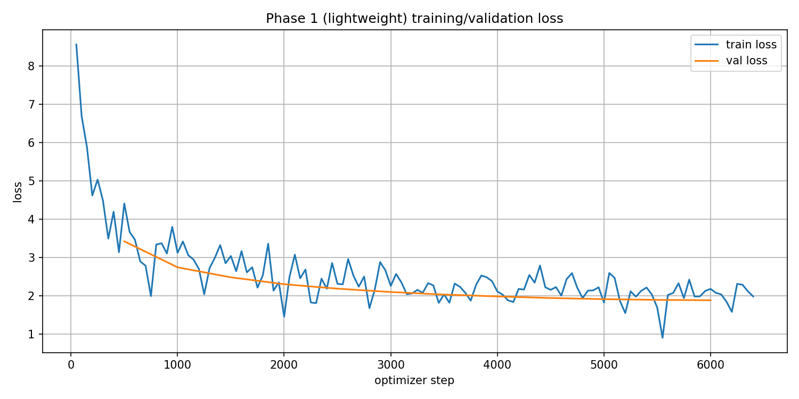

# Phase 1: run_lightweight

## Available evidence

This folder contains the saved loss plot exported from `MyDrive/cs781_phase1/run_lightweight/`. The folder name identifies the lightweight transformer run. No run configuration, numeric history, model metadata, verification report, or evaluation score was included in this export. See the [export manifest](../export_manifest.json).

The image is evidence of a saved plot; it does not independently establish training completion, exact hyperparameters, model selection, or Codabench acceptance. No numeric loss or task score has been inferred from the image.

## Implementation and reproduction

The current [Phase 1 notebook](../../../CS781_Phase1_Solution_Colab.ipynb) defines this architecture under `ARCHITECTURE = "lightweight"`, along with the data/tokenizer/training/generation pipeline. See the [phase instructions](../../../Phase1/README.md). This is implementation documentation, not proof that current notebook defaults match the historical run.

Preserve the notebook version, configuration cell output, or training logs actually used for this run before recording exact dimensions, token budgets, optimization settings, stopping criteria, and generation settings. The original code commit and checkpoint checksum are not available in the exported evidence.

## Artifact location and remaining records

The expected final checkpoint path, following the notebook’s layout, is `MyDrive/cs781_phase1/run_lightweight/final_model.pt`. Weights and prediction/submission files remain outside Git. This path has not been independently verified and does not grant access. The tokenizer is shared under `MyDrive/cs781_phase1/bpe_tokenizer/`; its exact pairing with this historical checkpoint still needs confirmation.

Record the actual Codabench submission ID, acceptance, BERTScore F1, and secondary metrics from your competition records. They are currently unavailable here. Do not substitute downstream task scores for Phase 1 evaluation.

[All Phase 1 results](../) · [All results](../../)
