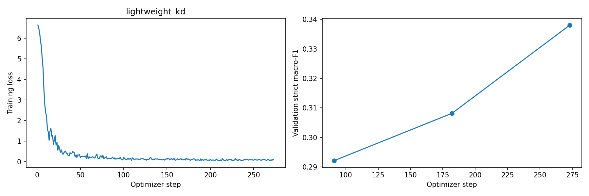

# Phase 2: lightweight_kd_v3

Legal named entity recognition using Knowledge distillation. Values below come from saved artifacts; training was not rerun for documentation.

## Method and implementation

The smaller lightweight student uses the recorded subset of Phase 1 blocks and trains its backbone and BIO head with supervised loss and teacher-logit distillation. The saved teacher identifier is documented below; a historical teacher checkpoint hash was not exported.

The [current notebook](../../../Phase2/CS781_Phase2_Solution_Colab.ipynb) implements BPE tokenization with character offsets, overlapping windows, a BIO token-classification head, document-level prediction merging, and strict entity-span evaluation. See the [phase instructions](../../../Phase2/README.md). It initializes from Phase 1 weights. The original training code commit was not exported, so exact correspondence with the linked current implementation remains to be confirmed.

## Saved configuration

| Setting | Value |
| --- | --- |
| Experiment / tag | `lightweight_kd` / `v3` |
| Phase 1 origin | Lightweight Transformer |
| Method | Knowledge distillation |
| Original Phase 1 parameter count | 102,451,968 |
| Task model total / trainable parameters | 63,533,593 / 63,533,593 |
| Seed / configured epochs | 42 / 3 |
| Batch size / gradient accumulation | 2 / 8 |
| Configured base learning rate | 5e-05 |
| Maximum sequence length / window overlap | 384 / 96 |
| Training / held-out validation documents | 60 / 10 |
| Weight decay / warmup fraction | 0.01 / 0.1 |
| Head dropout | 0.1 |
| Training complete (saved flag) | True |
| Head learning-rate multiplier | 5.0 |
| Class weights / O loss weight / maximum entity weight | True / 0.35 / 3.0 |
| Phase 1 block indices (zero based) | `[0, 2, 4, 6, 8, 10]` |
| Teacher identifier | `decoder_full` |
| KD weight / temperature | 0.5 / 2.0 |

Original Phase 1 configuration stored in the metadata:

```json
{
  "vocab_size": 32000,
  "n_layer": 12,
  "d_model": 768,
  "n_head": 12,
  "n_kv_head": 3,
  "d_ff": 2176,
  "max_len": 1024
}
```

Exact settings and split IDs: [run_config.json](run_config.json). Parameter counts, adapter targets, selected blocks, and teacher identifier: [model_metadata.json](model_metadata.json). Runtime details: [environment.json](environment.json). The original Phase 1 count may include components not used by the downstream task model.

## Held-out validation results

Strict entity matching requires the exact character span and entity label. Scores below use the 0–1 scale and average over all 12 entity labels. They are checkpoint/decoder selection scores, not private test estimates.

| Macro-F1 | Macro-precision | Macro-recall |
| ---: | ---: | ---: |
| 0.46162 | 0.49087 | 0.47957 |

At the saved checkpoint, greedy macro-F1 is 0.33805; the selected decoder achieves 0.46162. This is a decoding comparison at one checkpoint.

Selected decoder:

```json
{
  "method": "viterbi",
  "entity_bias": -0.3
}
```

### Per-label results

The table is rendered from [metrics.json](metrics.json); no separate per-label CSV was exported.

| Label | Precision | Recall | F1 | Support |
| --- | ---: | ---: | ---: | ---: |
| APP | 0.33333 | 0.50000 | 0.40000 | 14 |
| RESP | 0.31250 | 0.35714 | 0.33333 | 14 |
| A.COUNSEL | 0.34783 | 0.47059 | 0.40000 | 17 |
| R.COUNSEL | 0.28571 | 0.30769 | 0.29630 | 13 |
| JUDGE | 0.48387 | 0.65217 | 0.55556 | 23 |
| WIT | 0.50000 | 0.04348 | 0.08000 | 23 |
| AUTH | 0.52500 | 0.35294 | 0.42211 | 119 |
| COURT | 0.73171 | 0.74074 | 0.73620 | 81 |
| STAT | 0.74000 | 0.52113 | 0.61157 | 142 |
| PREC | 0.30476 | 0.29630 | 0.30047 | 108 |
| DATE | 0.92946 | 0.94515 | 0.93724 | 237 |
| CASENO | 0.39623 | 0.56757 | 0.46667 | 37 |

Checkpoint-selection scores: [best_validation_metrics.json](best_validation_metrics.json). Training history: [history.json](history.json).

## Training plot



## Verification and remaining records

The saved [verification.json](verification.json) reports passing validation, prediction ID/offset, and ZIP/JSON checks. The saved [post-training validation report](post_training_validation.json) reports checkpoint-reload agreement, validation schema/ID checks, JSON round-trip, and support-count verification. Decode evidence: [decoder_config.json](decoder_config.json) and [decoding_candidates.json](decoding_candidates.json). Saved class weights: [loss_class_weights.json](loss_class_weights.json). The metrics record training complete, but neither that flag nor exported verification establishes Codabench acceptance. The private test score and submission ID have not been recorded.

Expected checkpoint: `MyDrive/cs781_phase2/lightweight_kd_v3/best_model.pt`, following the original folder layout. This path has not been independently verified. Weights, predictions, and submission ZIPs remain in Drive. Historical code commits, checkpoint checksums, and teacher checkpoint hashes where applicable still need recording.

[All Phase 2 results](../) · [All results](../../)
