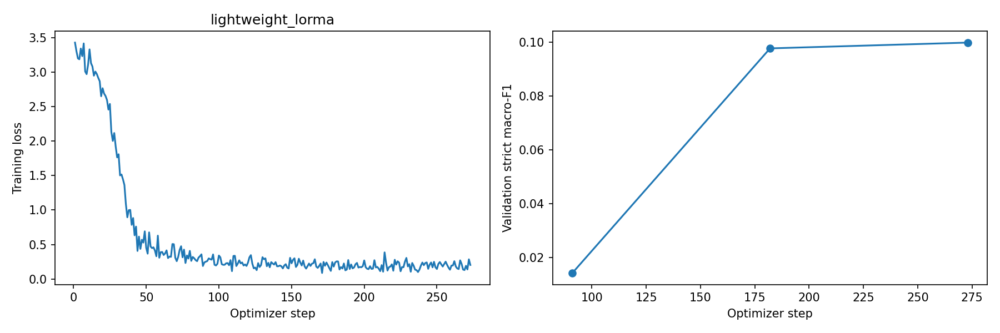

# Phase 2: lightweight_lorma_v1

Legal named entity recognition using LoRMA+. Values below come from saved artifacts; training was not rerun for documentation.

## Method and implementation

Attention projections use the notebook’s LoRMA+ multiplicative low-rank adaptation while the backbone weights are frozen; the BIO classification head is trainable. Exact targets are preserved in the model metadata.

The [current notebook](../../../Phase2/CS781_Phase2_Solution_Colab.ipynb) implements BPE tokenization with character offsets, overlapping windows, a BIO token-classification head, document-level prediction merging, and strict entity-span evaluation. See the [phase instructions](../../../Phase2/README.md). It initializes from Phase 1 weights. The original training code commit was not exported, so exact correspondence with the linked current implementation remains to be confirmed.

## Saved configuration

| Setting | Value |
| --- | --- |
| Experiment / tag | `lightweight_lorma` / `v1` |
| Phase 1 origin | Lightweight Transformer |
| Method | LoRMA+ |
| Original Phase 1 parameter count | 102,451,968 |
| Task model total / trainable parameters | 102,839,833 / 387,865 |
| Seed / configured epochs | 42 / 3 |
| Batch size / gradient accumulation | 2 / 8 |
| Configured base learning rate | 0.0002 |
| Maximum sequence length / window overlap | 384 / 96 |
| Training / held-out validation documents | 60 / 10 |
| Weight decay / warmup fraction | 0.01 / 0.1 |
| Head dropout | 0.1 |
| Training complete (saved flag) | True |
| Adapter rank / alpha | 8 / 8.0 |
| Adapter target modules | 48 |

This older configuration does not record head learning-rate multiplication, class-weight settings, or decoder optimization. Do not fill these fields from the current notebook defaults.

Original Phase 1 configuration stored in the metadata:

```json
{
  "vocab_size": 32000,
  "n_layer": 12,
  "d_model": 768,
  "n_head": 12,
  "n_kv_head": 3,
  "d_ff": 2176,
  "max_len": 1024
}
```

Exact settings and split IDs: [run_config.json](run_config.json). Parameter counts, adapter targets, selected blocks, and teacher identifier: [model_metadata.json](model_metadata.json). Runtime details: [environment.json](environment.json). The original Phase 1 count may include components not used by the downstream task model.

## Held-out validation results

Strict entity matching requires the exact character span and entity label. Scores below use the 0–1 scale and average over all 12 entity labels. They are checkpoint/decoder selection scores, not private test estimates.

| Macro-F1 | Macro-precision | Macro-recall |
| ---: | ---: | ---: |
| 0.09975 | 0.10300 | 0.10582 |

A separate baseline/selected-decoder comparison was not exported for this run.

### Per-label results

The table is rendered from [metrics.json](metrics.json); no separate per-label CSV was exported.

| Label | Precision | Recall | F1 | Support |
| --- | ---: | ---: | ---: | ---: |
| APP | 0.00000 | 0.00000 | 0.00000 | 14 |
| RESP | 0.00000 | 0.00000 | 0.00000 | 14 |
| A.COUNSEL | 0.00000 | 0.00000 | 0.00000 | 17 |
| R.COUNSEL | 0.00000 | 0.00000 | 0.00000 | 13 |
| JUDGE | 0.00000 | 0.00000 | 0.00000 | 23 |
| WIT | 0.00000 | 0.00000 | 0.00000 | 23 |
| AUTH | 0.10000 | 0.01681 | 0.02878 | 119 |
| COURT | 0.35294 | 0.37037 | 0.36145 | 81 |
| STAT | 0.08955 | 0.04225 | 0.05742 | 142 |
| PREC | 0.03097 | 0.06481 | 0.04192 | 108 |
| DATE | 0.64528 | 0.72152 | 0.68127 | 237 |
| CASENO | 0.01724 | 0.05405 | 0.02614 | 37 |

Checkpoint-selection scores: [best_validation_metrics.json](best_validation_metrics.json). Training history: [history.json](history.json).

## Training plot



## Verification and remaining records

No standalone `verification.json` was included in this export. A post-training validation report and decoder-selection artifacts were not included. The metrics record training complete, but neither that flag nor exported verification establishes Codabench acceptance. The private test score and submission ID have not been recorded.

Weights and checkpoint files are excluded from Git; checkpoint contents have not been independently verified.

[All Phase 2 results](../) · [All results](../../)
