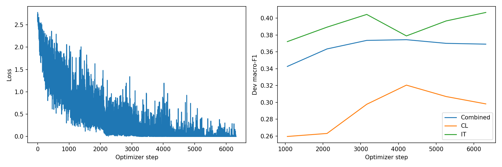
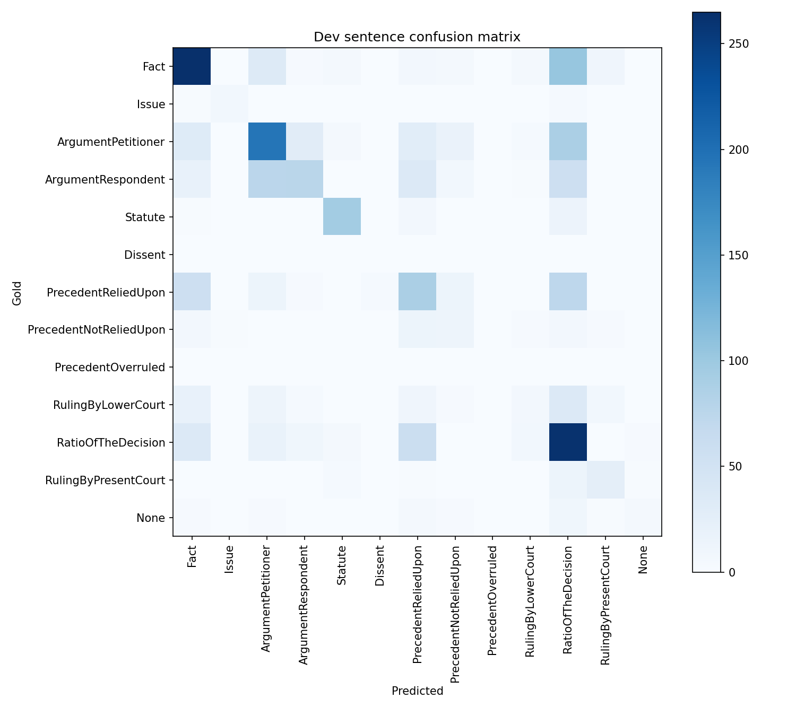

# Phase 3: decoder_full_v1

Rhetorical role prediction for CL and IT documents using full fine-tuning of the Phase 1 decoder-only backbone with a sentence-classification head. Values below come from the saved run artifacts, not from rerunning training.

## Saved configuration

| Setting | Value |
| --- | --- |
| Experiment / run tag | `decoder_full` / `v1` |
| Phase 1 backbone | 12 layers, hidden size 768, 12 heads, FFN size 3072 |
| Vocabulary / backbone maximum length | 32,000 / 1,024 |
| Total / trainable parameters | 111,630,445 / 111,630,445 |
| Seed | 42 |
| Configured maximum epochs / selected epoch | 6 / 4 |
| Batch size / gradient accumulation | 4 / 4 |
| Backbone / head learning rate | 0.00003 / 0.00015 |
| Maximum input / target tokens | 384 / 256 |
| Context sentences | 1 |
| Head dropout / weight decay | 0.15 / 0.01 |
| Warmup fraction / early-stopping patience | 0.1 / 3 |
| Class weighting | Enabled; power 0.5, maximum weight 4.0 |
| Selected transition strength / prior correction | 0.6 / 0.25 |

The implementation is in the [Phase 3 notebook](../../../CS781_Phase3_Solution_Colab.ipynb), with the pipeline described in the [Phase 3 README](../../../Phase3/README.md). It uses BPE-tokenized sentence inputs with context, a classification head, class-weighted training, and development-selected sequence decoding. See [run_config.json](run_config.json), [model_metadata.json](model_metadata.json), and [decoder_config.json](decoder_config.json) for the saved settings.

The original training code commit was not recorded in these artifacts. The linked notebook is the current repository version; exact correspondence with the historical training code still needs confirmation.

## Development results

Scores use the 0–1 scale. Combined scores pool the CL and IT sentences before computing the macro average across all 13 labels, including labels with zero support.

| Scope | Macro-F1 | Macro-precision | Macro-recall |
| --- | ---: | ---: | ---: |
| Combined dev | 0.37446 | 0.41899 | 0.36211 |
| CL dev | 0.32049 | 0.37041 | 0.32177 |
| IT dev | 0.37896 | 0.45231 | 0.36342 |

The combined development set contains 2,142 sentences. Greedy decoding at the saved checkpoint achieved macro-F1 0.36494; the selected decoder achieved 0.37446. This is a within-checkpoint decoding comparison. Development labels were used for checkpoint and decoder selection, so these are selection scores. Codabench score, submission ID, and acceptance have not yet been recorded.

Full scores: [metrics.json](metrics.json). Per-label results: [per_label_metrics.csv](per_label_metrics.csv). Selection evidence: [best_dev_metrics.json](best_dev_metrics.json), [best_selection_metrics.json](best_selection_metrics.json), and [decoding_candidates.json](decoding_candidates.json).

## Plots

## Verification and artifact locations

The saved [verification.json](verification.json) reports training complete, checkpoint-reload score agreement, train/dev/test separation, valid label vocabulary, test ID/sentence-order checks, and ZIP/JSON round-trip checks. These saved checks do not prove Codabench acceptance. The development aggregate metric and confusion-matrix sentence total were also checked when preparing this documentation.

Checkpoints remain at `MyDrive/cs781_phase3/decoder_full_v1/best_model.pt` and `MyDrive/cs781_phase3/decoder_full_v1/last.pt`. Predictions and `submission.zip` remain in that Drive folder. These paths identify storage locations; they do not grant access.

Additional evidence: [history.json](history.json) and [loss_class_weights.json](loss_class_weights.json).
