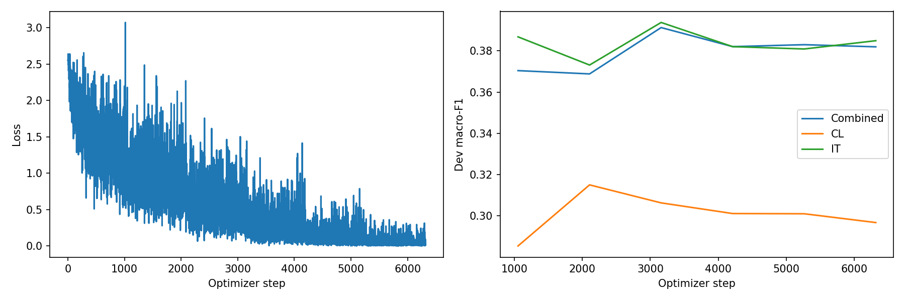
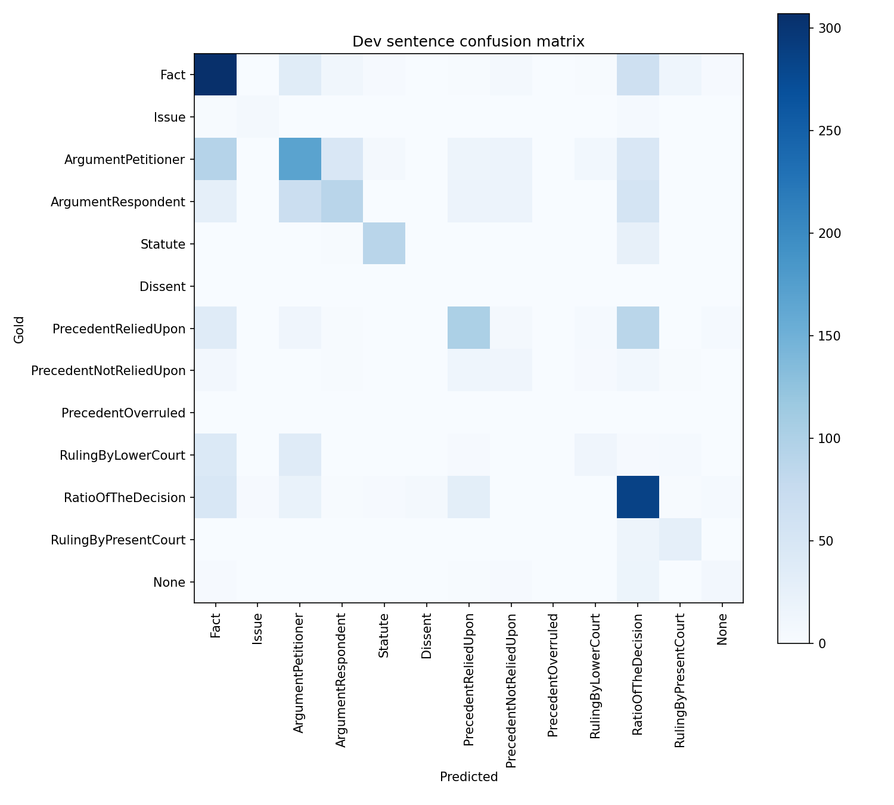

# Phase 3: lightweight_lorma_v1

Rhetorical role prediction for CL and IT documents using LoRMA+ with the Phase 1 lightweight origin. This page records the exported configuration and metrics; training was not rerun for documentation.

## Method and implementation

The backbone weights are frozen; attention projections use the LoRMA+ multiplicative low-rank adaptation implemented in the notebook, together with a trainable classification head.

The current [Phase 3 notebook](../../../Phase3/CS781_Phase3_Solution_Colab.ipynb) contains data loading, BPE tokenization, context-aware sentence inputs, classification, training, and prediction. See the [phase instructions](../../../Phase3/README.md). All downstream runs initialize from Phase 1 rather than Phase 2 weights.

The original training code commit was not recorded in these artifacts. The linked notebook is the current repository version; its exact correspondence with the historical training code still needs confirmation.

## Saved configuration

| Setting | Value |
| --- | --- |
| Experiment / run tag | `lightweight_lorma` / `v1` |
| Phase 1 origin | Lightweight |
| Adaptation | LoRMA+ |
| Original Phase 1 parameters | 102,451,968 |
| Task model total / trainable parameters | 104,032,621 / 1,580,653 |
| Trainable fraction | 1.52% |
| Seed | 42 |
| Configured maximum epochs / selected epoch | 6 / 3 |
| Batch size / gradient accumulation | 4 / 4 |
| Configured base / head learning rate | 0.0002 / 0.001 |
| Maximum input / target tokens | 384 / 256 |
| Context sentences | 1 |
| Head dropout / weight decay | 0.15 / 0.01 |
| Warmup fraction / early-stopping patience | 0.1 / 3 |
| Class weighting | Enabled; power 0.5, maximum 4.0 |
| Gradient checkpointing | True |
| Selected transition strength / prior correction | 0.6 / 0.25 |
| Adapter rank / alpha | 8 / 16.0 |
| Adapter target modules | 48 |

Original Phase 1 architecture configuration:

```json
{
  "vocab_size": 32000,
  "n_layer": 12,
  "d_model": 768,
  "n_head": 12,
  "n_kv_head": 3,
  "d_ff": 2176,
  "max_len": 1024
}
```

The source of truth is [run_config.json](run_config.json). Parameter counts, selected blocks, and exact adapter targets are in [model_metadata.json](model_metadata.json). Decode settings are in [decoder_config.json](decoder_config.json). Adapter and KD defaults in the common configuration apply only when that method uses them.

## Development results

Scores use the 0–1 scale. The combined score pools CL and IT sentences and then averages across all 13 labels, including zero-support labels. It is not the average of the two domain scores.

| Scope | Macro-F1 | Macro-precision | Macro-recall |
| --- | ---: | ---: | ---: |
| Combined dev | 0.39126 | 0.43397 | 0.37790 |
| CL dev | 0.30634 | 0.33048 | 0.31919 |
| IT dev | 0.39373 | 0.45697 | 0.37413 |

The combined development set contains 2,142 sentences. At the saved checkpoint, greedy macro-F1 is 0.37394 and selected-decoder macro-F1 is 0.39126. This compares decoding at one checkpoint, not two independently trained models. Development labels were used for checkpoint and decoder selection; these are selection scores. Codabench score, submission ID, and acceptance have not yet been recorded.

Full scores: [metrics.json](metrics.json). Per-label results: [per_label_metrics.csv](per_label_metrics.csv). Selection evidence: [best_dev_metrics.json](best_dev_metrics.json), [best_selection_metrics.json](best_selection_metrics.json), and [decoding_candidates.json](decoding_candidates.json).

## Plots





## Verification and artifacts

The saved [verification.json](verification.json) reports training complete and passing checkpoint-reload, development JSON round-trip, label vocabulary, test ID/order, submission ZIP round-trip, and train/dev/test separation checks. These saved checks do not establish Codabench acceptance.

Recorded test output coverage: 10 documents and 2,197 sentences. Checkpoints are expected at `MyDrive/cs781_phase3/lightweight_lorma_v1/best_model.pt` and `MyDrive/cs781_phase3/lightweight_lorma_v1/last.pt`, following the original run-folder layout. These Drive paths have not been independently checked here and do not grant access. Predictions and submission ZIPs remain in Drive.

Training history: [history.json](history.json). Class weights: [loss_class_weights.json](loss_class_weights.json).

[All Phase 3 results](../) · [All results](../../)
