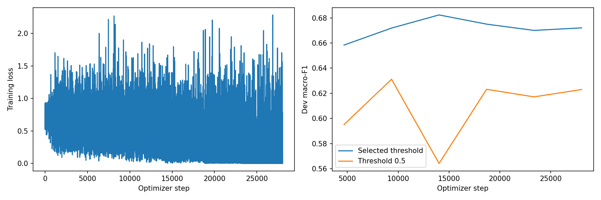
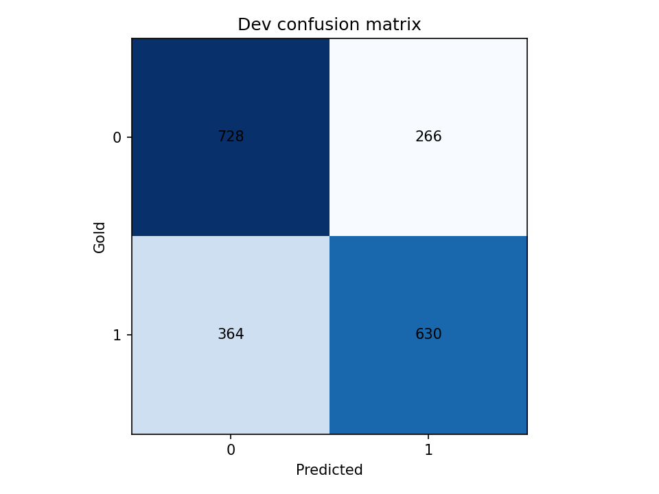

# Phase 4: lightweight_lorma_v1

Court judgment prediction with one binary outcome per case. Saved artifacts supply the settings and scores below; training was not rerun for this documentation.

## Method and implementation

The run uses **LoRMA+** from the Phase 1 `lightweight` origin. The [current solution notebook](../../../Phase4/CS781_Phase4_Solution_Colab.ipynb) implements chunked document representation, `attention` pooling, and a task head; see the [phase instructions](../../../Phase4/README.md) for method details. The historical training code commit was not recorded, so exact correspondence with the current notebook remains unconfirmed.

## Saved configuration

| Setting | Value |
| --- | --- |
| Experiment / run tag | `lightweight_lorma` / `v1` |
| Phase 1 origin | lightweight |
| Method | LoRMA+ |
| Phase 1 parameter count | 102,451,968 |
| Task model total / initially trainable parameters | 103,088,267 / 636,299 |
| Finally trainable parameters | 636,299 |
| Seed | 42 |
| Maximum epochs / best epoch | 6 / 3 |
| Case batch / accumulation | 2 / 4 |
| Base learning rate / head multiplier | 0.0002 / 5.0 |
| Chunk length / overlap / maximum chunks | 384 / 64 / 4 |
| Training / evaluation chunk policy | spread / spread |
| Chunk microbatch size | 4 |
| Document pooling / hidden dimension | attention / 128 |
| Dropout / weight decay | 0.15 / 0.01 |
| Warmup fraction / patience | 0.1 / 3 |
| LoRMA rank / alpha | 8 / 16.0 |

Exact settings: [run_config.json](run_config.json). Original architecture, adapter targets, parameter counts, selected blocks, and teacher metadata: [model_metadata.json](model_metadata.json). Class/label weights: [class_weights.json](class_weights.json). Common adapter/KD defaults apply only to methods that use them.

## Development results

Macro-F1 averages outcome classes 0 and 1. Secondary precision/recall below are for class 1.

| Macro-F1 | Class-1 precision | Class-1 recall | Accuracy |
| ---: | ---: | ---: | ---: |
| 0.68233 | 0.70312 | 0.63380 | 0.68310 |

Selected probability threshold: **0.143188**. Prediction rule: class 1 when its probability is at least the threshold.

Development cases: 1,988. At the same saved checkpoint, the 0.5 baseline macro-F1 is 0.56420, versus 0.68233 after threshold selection. This is a within-checkpoint threshold comparison, not a comparison of separately trained models. Dev labels selected checkpoints and thresholds, so these are selection scores. Official test score, Codabench ID, and acceptance remain unrecorded.

Full scores: [metrics.json](metrics.json). Checkpoint-selection evidence: [best_dev_metrics.json](best_dev_metrics.json). Thresholds: [threshold.json](threshold.json).

## Document coverage

Only a sampled portion of long documents may be represented. Saved coverage is not a claim of reading every token.

| Split | Cases | Mean token coverage | Mean chunks |
| --- | ---: | ---: | ---: |
| train | 37,387 | 56.84% | 3.58 |
| dev | 1,988 | 41.70% | 3.94 |
| test | 1,517 | 41.09% | 3.94 |

[Full chunk coverage report](chunk_coverage.json).

## Plots

## Verification and artifact locations

[verification.json](verification.json) reports training complete and passing checkpoint-reload, dev JSON round-trip, original test ID/type, output-format, ZIP, and separation checks. These are saved reports, not a fresh official-data evaluation or proof of competition acceptance.

Weights and checkpoint files are excluded from Git; checkpoint contents have not been independently verified.

[All Phase 4 results](../) · [All results](../../)
