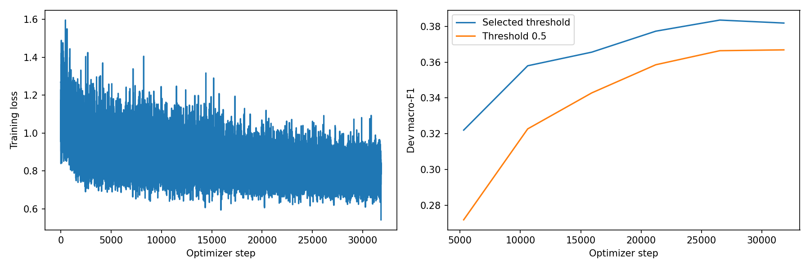
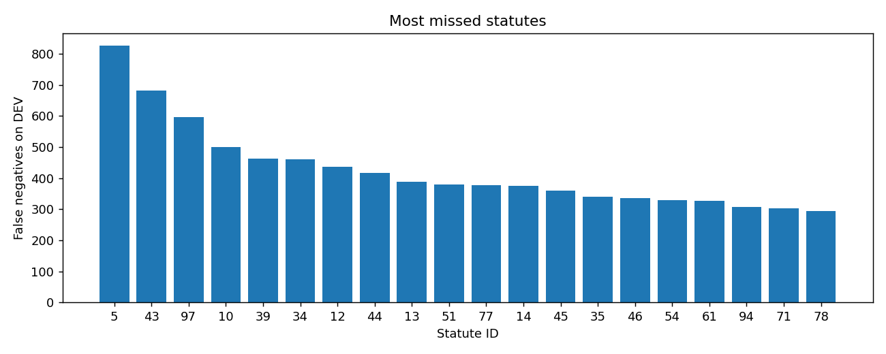

# Phase 5: lightweight_kd_v1

Legal statute identification with independent multi-label statute decisions. Saved artifacts supply the settings and scores below; training was not rerun for this documentation.

## Method and implementation

The run uses **Knowledge distillation** from the Phase 1 `lightweight` origin. The [current solution notebook](../../../Phase5/CS781_Phase5_Solution_Colab.ipynb) implements chunked document representation, `attention` pooling, and a task head; see the [phase instructions](../../../Phase5/README.md) for method details. The historical training code commit was not recorded, so exact correspondence with the current notebook remains unconfirmed.

The smaller student is initialized from the recorded Phase 1 blocks and trained with supervised targets plus teacher distillation. The teacher run and signature are preserved in [model_metadata.json](model_metadata.json); the referenced checkpoint has not been loaded or independently verified here.

## Saved configuration

| Setting | Value |
| --- | --- |
| Experiment / run tag | `lightweight_kd` / `v1` |
| Phase 1 origin | lightweight |
| Method | Knowledge distillation |
| Phase 1 parameter count | 102,451,968 |
| Task model total / initially trainable parameters | 63,794,669 / 63,794,669 |
| Finally trainable parameters | 63,794,669 |
| Seed | 42 |
| Maximum epochs / best epoch | 6 / 5 |
| Case batch / accumulation | 2 / 4 |
| Base learning rate / head multiplier | 5e-05 / 5.0 |
| Chunk length / overlap / maximum chunks | 384 / 64 / 4 |
| Training / evaluation chunk policy | spread / spread |
| Chunk microbatch size | 4 |
| Document pooling / hidden dimension | attention / 128 |
| Dropout / weight decay | 0.15 / 0.01 |
| Warmup fraction / patience | 0.1 / 3 |
| Phase 1 block indices | `[0, 2, 4, 6, 8, 10]` |
| Recorded teacher run | `decoder_full_v1` |
| KD weight / temperature | 0.5 / 2.0 |

Loss: `bce`; metric-label scope: `reference_range`; 100 output labels. Positive-weight cap: 20.0; label smoothing: 0.0; label graph weight: 0.0.

Exact settings: [run_config.json](run_config.json). Original architecture, adapter targets, parameter counts, selected blocks, and teacher metadata: [model_metadata.json](model_metadata.json). Class/label weights: [class_weights.json](class_weights.json). Common adapter/KD defaults apply only to methods that use them.

## Development results

Macro-F1 is over statute decisions under the saved `reference_range` scope, rather than over binary outcome classes. Other scope variants are preserved in the metrics file.

| Macro-F1 | Micro-F1 | Subset accuracy |
| ---: | ---: | ---: |
| 0.38345 | 0.47414 | 0.03585 |

Selected threshold policy: `shrunk_per_label`. Exact per-label thresholds and empty-output policy are in [threshold.json](threshold.json).

Development cases: 10,181. At the same saved checkpoint, the 0.5 baseline macro-F1 is 0.36637, versus 0.38345 after threshold selection. This is a within-checkpoint threshold comparison, not a comparison of separately trained models. Dev labels selected checkpoints and thresholds, so these are selection scores. Official test score, Codabench ID, and acceptance remain unrecorded.

Full scores: [metrics.json](metrics.json). Checkpoint-selection evidence: [best_dev_metrics.json](best_dev_metrics.json). Thresholds: [threshold.json](threshold.json).

[Per-statute metrics](per_label_metrics.csv) include support and TP/FP/FN counts.

## Document coverage

Only a sampled portion of long documents may be represented. Saved coverage is not a claim of reading every token.

| Split | Cases | Mean token coverage | Mean chunks |
| --- | ---: | ---: | ---: |
| train | 42,426 | 82.16% | 2.55 |
| dev | 10,181 | 79.53% | 2.68 |
| test | 13,019 | 80.51% | 2.68 |

[Full chunk coverage report](chunk_coverage.json).

## Plots

## Verification and artifact locations

[verification.json](verification.json) reports training complete and passing checkpoint-reload, dev JSON round-trip, original test ID/type, output-format, ZIP, and separation checks. These are saved reports, not a fresh official-data evaluation or proof of competition acceptance.

Saved overlap policy: `exclude_train`; remaining train instances matching held-out text: 0. Full split-audit files were not part of this export, so their details are not independently established here.

Weights and checkpoint files are excluded from Git; checkpoint contents have not been independently verified.

[All Phase 5 results](../) · [All results](../../)

## Matched official best submission

Submission **1011686**, reported rank **80**, matches this run’s prediction JSON and ZIP across **13,019 case predictions**. It is the only matching run folder among **12 compared artifacts**, with no errors. The saved configuration checksum agrees with this folder’s [run_config.json](run_config.json). See [matching evidence](../best_submission_match.json) and the [official result record](../official_best.json).

Official displayed scores are **Macro-F1 0.3622**, **Micro-F1 0.4565**, and **Subset Accuracy 0.0336**. These rounded test results are separate from the saved local-dev Macro-F1 **0.38344562397413307**. The author confirmed **6 distinct valid submissions**. The matched configuration records architecture `lightweight`, method `kd`, experiment `lightweight_kd`, and tag `v1`. Checkpoint weights and historical training commits were not independently verified; rank-recording date remains pending.
