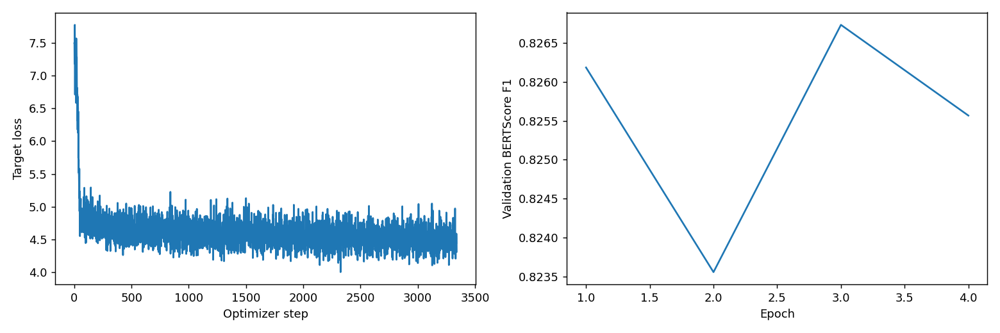

# Phase 6: encoder_adapters_v1

Abstractive legal summarization. This page documents saved artifacts; training and official evaluation were not rerun.

## Method and implementation

The saved configuration uses **Houlsby adapters** with the Phase 1 `encoder_decoder` origin. See the [current solution notebook](../../../Phase6/CS781_Phase6_Solution_Colab.ipynb) and [phase instructions](../../../Phase6/README.md). The saved implementation version is `1`; the historical Git commit was not exported, so exact correspondence with the current code remains unconfirmed.

The generation model retains its pretrained language-model output head. The encoder-decoder origin uses both encoder and decoder, rather than only its encoder. Training uses source/reference-summary pairs from the fitting split.

## Saved settings

| Setting | Value |
| --- | --- |
| Experiment / run tag | `encoder_adapters` / `v1` |
| Phase 1 origin | encoder_decoder |
| Method | Houlsby adapters |
| Total / trainable parameters | 126,782,336 / 3,020,160 |
| Seed | 42 |
| Configured epochs / selected epoch | 4 / 3 |
| Base learning rate | 0.0002 |
| Weight decay / warmup fraction | 0.01 / 0.1 |
| Early-stopping patience | 2 |
| Gradient accumulation | 4 |
| Adapter bottleneck dimension | 64 |
| Document batch size | 2 |
| Source / target token budgets | 640 / 256 |
| Source selection policy | head_tail |
| Encoder chunk size | 0 |
| Label smoothing | 0.1 |
| Epoch / final validation limits | 128 / 0 (0 means all held-out documents) |

Exact settings: [run_config.json](run_config.json). Original architecture, parameter counts, selected blocks and teacher metadata: [model_metadata.json](model_metadata.json). Common adapter/KD settings apply only to the chosen method.

## Evaluation results

The official Phase 6 data has no public dev file. The exported split manifest records 6,677 fitting documents, 351 held-out validation documents, and 100 test documents. Two training rows with empty summaries were excluded before splitting. Saved train/validation IDs are disjoint; the export does not independently recheck source-text grouping.

Checkpoints were selected on a fixed **128-document** held-out subset, with selected-checkpoint BERTScore F1 **0.82673**. The table below is the final evaluation over **all 351 held-out documents** (`full_validation = True`). These are different evaluation scopes and their numbers need not match.

| BERTScore F1 | ROUGE-1 F1 | ROUGE-L F1 |
| ---: | ---: | ---: |
| 0.82665 | 0.32482 | 0.17886 |

BERTScore configuration: `roberta-large`, layer 17, rescaling `False`, IDF `False`. Saved scorer hash: `roberta-large_L17_no-idf_version=0.3.12(hug_trans=4.57.6)`. ROUGE stemming: `True`. This pretrained model is used for evaluation, not as the summarization backbone.

Generation settings:

```json
{
  "num_beams": 2,
  "max_new_tokens": 256,
  "min_new_tokens": 24,
  "length_penalty": 1.0,
  "repetition_penalty": 1.1,
  "no_repeat_ngram_size": 3,
  "deduplicate_sentences": false,
  "long_document_mode": "select",
  "map_reduce_max_chunks": 4
}
```

Mean generated/reference word counts: 208.0 / 838.8. Inspect truncation and source-budget limits before interpreting summary quality. Final metrics score against the held-out references; full validation does not mean full-document token coverage.

Evidence: [metrics.json](metrics.json), [best_selection_metrics.json](best_selection_metrics.json), [selection_manifest.json](selection_manifest.json), [generation_config.json](generation_config.json).

## Context limits

The saved source policy selects a bounded input from each document. The coverage upper bound is a budget statistic, not measured full-context reading.

| Split | Documents | Mean source-budget coverage upper bound | References exceeding target budget |
| --- | ---: | ---: | ---: |
| train | 6,677 | 21.76% | 96.02% |
| dev | 351 | 21.34% | 95.16% |
| test | 100 | 20.91% | No public reference |

Reference-budget fractions describe target-length limitations, not a claim that evaluation references were shortened. See [context_coverage.json](context_coverage.json).

## Training plot and verification



[history.json](history.json) preserves numeric training records. Saved [verification.json](verification.json) reports training complete and passing checkpoint-reload, JSON round-trip, original-ID/submission-format and ZIP checks. These are saved reports, not a new official-data evaluation or confirmation of Codabench acceptance. Development/held-out data were used for selection, and comparison across many runs can overestimate generalization. The private test score and submission ID remain unrecorded. No standalone environment report was exported.

## Artifact storage

The configuration, metrics, history, verification, available plots, and task-specific policy files in this folder are included in the repository.

Weights and checkpoint files are excluded from Git; checkpoint contents have not been independently verified.

[All Phase 6 results](../) · [All results](../../)
