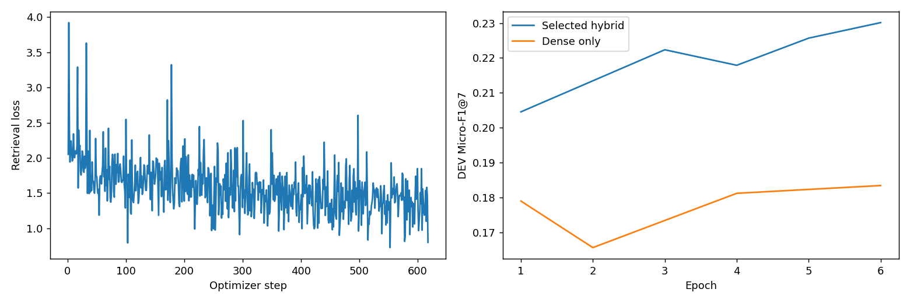

# Phase 7: hybrid_lorma_v1

Prior case retrieval with seven ranked candidate IDs per query. This page documents saved artifacts; training and official evaluation were not rerun.

## Method and implementation

The saved configuration uses **LoRMA+** with the Phase 1 `hybrid_prefixlm` origin. See the [current solution notebook](../../../Phase7/CS781_Phase7_Solution_Colab.ipynb) and [phase instructions](../../../Phase7/README.md). The saved implementation version is `1`; the historical Git commit was not exported, so exact correspondence with the current code remains unconfirmed.

The retrieval model encodes queries and cases into document representations. Evaluation uses each split’s own complete candidate pool; the saved ranking policy may combine neural and BM25 ranks. The encoder-decoder origin contributes its encoder.

## Saved settings

| Setting | Value |
| --- | --- |
| Experiment / run tag | `hybrid_lorma` / `v1` |
| Phase 1 origin | hybrid_prefixlm |
| Method | LoRMA+ |
| Total / trainable parameters | 100,223,873 / 887,809 |
| Seed | 42 |
| Configured epochs / selected epoch | 6 / 6 |
| Base learning rate | 0.0002 |
| Weight decay / warmup fraction | 0.01 / 0.1 |
| Early-stopping patience | 3 |
| Gradient accumulation | 4 |
| Low-rank dimension / alpha | 8 / 16.0 |
| Query batch size | 2 |
| Positives / sampled negatives per query | 2 / 4 |
| Hard-negative fraction | 0.75 |
| In-batch negatives / dense-negative mining | True / False |
| Chunk length / overlap / maximum chunks | 256 / 48 / 3 |
| Chunk policy / pooling | spread / attention |
| Embedding dimension | 256 |
| Loss / temperature | multi_positive / 0.05 |
| Head learning-rate multiplier | 3.0 |

Exact settings: [run_config.json](run_config.json). Original architecture, parameter counts, selected blocks and teacher metadata: [model_metadata.json](model_metadata.json). Common adapter/KD settings apply only to the chosen method.

## Evaluation results

Micro-F1@7 aggregates hits over all queries and compares exactly seven retrieved IDs per query against each complete gold set, without truncating the gold sets. Selected scores may include BM25 fusion and late interaction; dense-only scores are reported separately.

| Selected Micro-F1@7 | Micro-precision@7 | Micro-recall@7 | Dense-only Micro-F1@7 | BM25 Micro-F1@7 |
| ---: | ---: | ---: | ---: | ---: |
| 0.23013 | 0.25061 | 0.21274 | 0.18344 | 0.11895 |

Evaluated dev queries: 118; retrieved IDs: 826; total gold relevance entries: 973; hits: 207. Selected ranking policy:

```json
{
  "neural_mode": "dense",
  "dense_weight": 0.75,
  "rrf_k": 60,
  "rrf_depth": 200,
  "citation_weight": 0.0
}
```

Evidence: [metrics.json](metrics.json), [best_dev_metrics.json](best_dev_metrics.json), [dense_dev_metrics.json](dense_dev_metrics.json), [retrieval_policy.json](retrieval_policy.json), [ranking_trials.json](ranking_trials.json). The BM25 baseline is a separate non-neural baseline and does not count as another trained adaptation experiment.

## Token coverage

Saved mean document-token coverage by encoding group:

| Group | Mean coverage |
| --- | ---: |
| dev_queries | 17.14% |
| dev_candidates | 23.73% |
| test_queries | 20.69% |
| test_candidates | 23.86% |

These are sampled chunk representations, not complete document coverage. See [chunk_coverage.json](chunk_coverage.json).

## Training plot and verification



[history.json](history.json) preserves numeric training records. Saved [verification.json](verification.json) reports training complete and passing checkpoint-reload, JSON round-trip, original-ID/submission-format and ZIP checks. These are saved reports, not a new official-data evaluation or confirmation of Codabench acceptance. Development/held-out data were used for selection, and comparison across many runs can overestimate generalization. The private test score and submission ID remain unrecorded. No standalone environment report was exported.

## Artifact storage

Expected checkpoint path: `MyDrive/cs781_phase7/hybrid_lorma_v1/best_model.pt` in **your friend’s Drive account**. The checkpoint path is recorded from the original folder layout and has not been independently verified. It must not be interpreted as a checkpoint already copied into your own Drive. Weights, embeddings, predictions/generated summaries, caches and submission ZIPs remain outside Git.

[All Phase 7 results](../) · [All results](../../)
